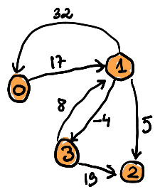

# Generating a notebook

The script `make_notebook.py` generates a notebook from the tryalgo library to be used during an ICPC competition. It works along these lines.

- every Python source code from the library is parsed. Codes within comments `# snip{` and `# snip}` are added to the notebook, except if preceded by a comment `# icpc-ignore`. The codes are grouped in sections, using a title, which consists by default of the basename of the Python source file, replacing underscores by spaces and capitalizing the words. A comment `# icpc-title My Title` can be used to overwrite this default choice.
- If there is a file in the `notebook/figure` directory with the same basename then it is included right after the section title. The height of this figure can be configured in the command line argument of the script. However if there is a file with the extension `.typ`, then this file is included instead.
- A file called `title.typ` is inserted at the beginning of the notebook.
- The resulting notebook is written in the format `Typst`, which is an elegant alternative to LaTeX.
- We borrow an interesting feature from the KACTL (KTH Algorithm Competition Template Library), namely every code snippet is annotated with a 6 digit hashode. When typing the source code during the competition, one can run the verification script, given in the header of the notebook. The hashcode is sensitive to the variable names, but ignores comments. It considers indentation, but not the number of spaces used to ident.
- The footer summarizes the sections of the page. Hence if printed single sided, one can use this information as a table of content. 
  
## How to use it for your team

- you can change those `# snip` comments to select the implementations you want to see in your notebook.
- you can personalize your university and team name using the `--team` command line argument of `make_notebook.py`.

## Tested code

All the codes have undergone some unit tests. When you push modifications in this github repository an action script will run the tests and regenerate the notebook.

## Graphs

Essentially you can work with two graph representations. Consider the following example graph,
were we choose to use integer arc weights, but they could be floating point numbers for example.



### list[list[int]]

We number all the vertices starting from 0, and use an adjacency list representation for the outgoing arcs. If the graph is not directed every edge needs to be inserted twice, for each orientation of the edge. The order of the neighbors do not matter.
Arc weights are stored in a squared matrix.

```python
# vertex 0:   1:       2:  3:
graph = [[1], [0,2,3], [], [1]]
weights = [[None, 17,   None, None],
           [32,   None, 5,    -4  ],
           [None, None, None, None].
           [None, 8,    19,   None]]
``` 

### list[dict[int, int]]

Here we store the adjacency list together with the arc weights in a single dictionary.

```python
# vertex 0:   1:       2:  3:
graph = [{1: 16}, {0: 22, 2: 5,3: -4}, {}, {1: 8}]
``` 

Both data structures allow a similar access to the stored information. 

- `len(graph)` gives the number of vertices. 
- `for v in graph[u]` allows to loop over all arcs (u, v) for given u.
- `weight[u][v]` or `graph[u][v]` retrieves the weight of the arc (u,v)

For this reason the code from this notebook can work with either representation, and you use choose the one which suits you better.


Good luck, and don't panic.
